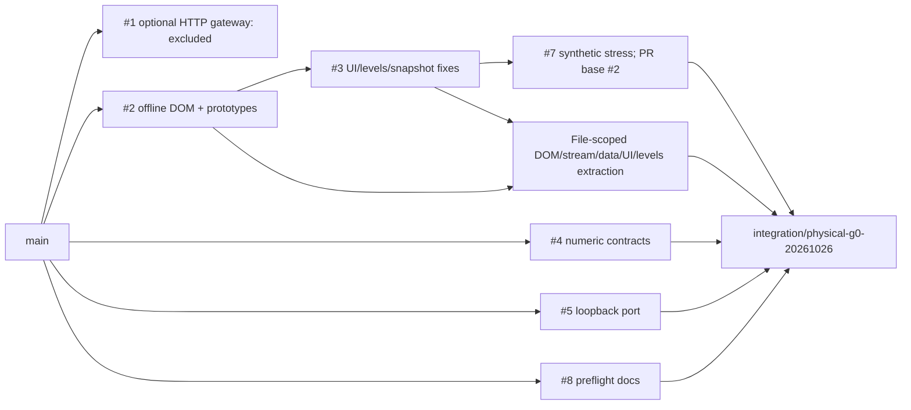

# Physical G0 release and rollback

This is a read-only integration candidate, not a production release. No merge is
authorized. The generated handoff report and PR comment identify the exact final
SHA and CI run/attempt; never substitute a mutable branch or an earlier green SHA.
This runbook supersedes the fixed-port manual example in
`windows_g0_readonly_preflight.md`, retained with original PR #8 provenance.

## Source graph and selected patches



| Source PR | Exact audited head | Integration decision |
|---|---|---|
| #1 | dd1663c79290f2d16c292b7fde1e3a4122acb604 | Reviewed optional loopback HTTP gateway; excluded. It adds alternate authority/port configuration unnecessary for direct DB G0. No remote gateway is enabled. |
| #2 | df29c74fb23d3092eb4c3fb69c93e19ec460fb39 | Only offline DOM/stream contracts, nullable Grid POC and historical research safety; prototype renderer/comparison/UI pages excluded. |
| #3 | d1ba232e40d471894da6d5d84d078c8d73a97c46 | UI syntax/generation fencing, completion, levels quality, snapshot watermark; server levels hunk adapted over #5, then strict source gate. |
| #4 | 15c8fcf835db23ca1cbea1f7d2705fa99b41fac9 | Full minimal two-file numeric patch, `cherry-pick -x`. |
| #5 | c711f9ce13678e3777c9707a2f34b5c30ce2dbb8 | Full port patch, `cherry-pick -x`; no textual conflict. |
| #7 | a39a9c1b6cead4a13600d756f921c19a811df1a3 | Stress test only, `cherry-pick -x`; faulty GAP fixture corrected. |
| #8 | cee3a266c5bd10c8555645b63ab2ffd99a650cca | Original preflight retained, `cherry-pick -x`; executable harness added separately. |

File extraction preserves source author YehorBabenko88; commit body records source
PRs/SHAs. Original whole commits for #4/#5/#7/#8 preserve author and `-x` provenance.
No bulk merge or edits to source branches. Source main SHA is
`fee79f4b15fc1f9efcff9ca12c403688b0026260`.

## Runtime contracts

`contracts.lock.json` pins Grid main
`d537d525296ef34f727996e240ae6c60102c6082` and Strattester main
`37ff7e9d12a4d2dccd788fc493c28557dbe8bcea`, plus canonical source-file SHA256.
Tests require these checkouts; absence or drift is a failure, never a skip.
Canonical schema files come from `git show`, avoiding Windows CRLF hash drift.
Synthetic SQLite uses the actual pinned SCHEMA_SQL/version and ResultStore.
Hosted PG18 tests instantiate the actual pinned Grid DDL in a disposable DB.
Fixture writes exist only in tests against synthetic stores. Runtime performs
SELECT/SHOW/introspection and read-only transactions; it performs no migration.

`GET /api/sources?symbol=BTCUSDT&timeframe=1h` returns versioned source envelopes.
Each names source, symbol, actual timeframe, observed UTC milliseconds, schema
version, bounded coverage, state and provenance. SQLite market version must be 2;
Grid server major must be 18 and required public columns/types must match.
Grid/research have no upstream numeric schema version: the structural adapter
version is named explicitly. Contract pin is distinct from runtime source SHA,
which remains UNVERIFIED until independently evidenced. Unknown optional columns
are allowed; missing/incompatible required fields fail closed.
Grid health uses the pinned nodes table with a 200-row limit, validates PG18 and
required types, omits hostname, and exposes stale/online telemetry separately.

Research created_at seconds are normalized to UTC integer milliseconds; it is
HISTORICAL_ONLY with publication/fencing UNVERIFIED. Grid footprint/candles are
AGGREGATED_HISTORY_NOT_L2. Grid is fixed 1m even beside another chart timeframe.
No source exposes live L2 or individual executed tape. L2 remains UNAVAILABLE.
Null Grid POC is supported. Malformed timestamps, OHLC, nonfinite numbers and
invalid metrics clear rows and yield INVALID_DATA; schema mismatch and unavailable
sources are distinct. Independent components survive a partial source failure.
Coverage is only the returned bounded window, never proof of whole-history
completeness. Stale tail (>120s after newest period end), gaps, incomplete bars and
irregular spacing are explicit; historical research is never live authority.

DOM continuity uses strictly increasing sequence plus matching previous_sequence;
2010 -> 2012, previous=2010 is valid. GAP requires a mismatched link. Duplicate or
old snapshots cannot recover GAP/STALE/DISCONNECTED; retired epochs cannot return.
Retired epoch history is bounded at 128; replace the offline engine on exhaustion.
Batch and total book caps are 100,000 levels; stream cache 128 symbols and queue
4096. Overflow invalidates books and requires a fresh snapshot. No live networking
adapter is connected. Synthetic sequence tests do not establish exchange authority.

HTTP permits loopback only, validates Host/Origin, bounds 16 concurrent requests,
5s socket idle timeout, 2048-character paths and 12 query fields. SQLite has a 2s
execution progress deadline plus lock timeout; PG has 3s connect/statement timeout
and 1s lock timeout. Queries cap market rows at 300 and research rows at 50.
UI aborts superseded fetches, fences every async write, and times requests out at
15s. Cancellation does not cancel an already executing server query; DB timeouts
and HTTP concurrency bounds limit residual work. API returns generic source errors;
request query logging is disabled.

## Safe physical sequence

1. Use an ordinary non-admin PS5.1 or PS7 terminal. Git, Python 3.11+ and a browser
   must already be installed. Do not install services, alter ACLs/firewall, migrate
   DBs, enable G1 Execute/Cleanup, use exchange credentials or start trading.
2. Use a dedicated clean checkout and `git checkout --detach <FINAL_EXACT_SHA>`.
   Confirm `git rev-parse HEAD` equals the handoff SHA. Do not pull while collecting
   evidence. To run offline tests first, place the pinned Grid and Strattester
   checkouts as sibling directories `grid` and `strattester`, or set GRID_REPO and
   STRATTESTER_REPO to their clean pinned paths. Then run Python unittest discovery
   and both Node scripts. Synthetic tests write only their temporary fixtures.
3. Run the exact command from the handoff, replacing no SHA:

   ```powershell
   .\scripts\Invoke-G0.ps1 -ExpectedSha '<FINAL_EXACT_SHA>' -OpenBrowser -ReviewSeconds 600
   ```

   The harness clears all inherited TERMINAN_* values in the child only. No DSN,
   DB or gateway is used. The child binds 127.0.0.1 port 0 and publishes the actual
   owned port after binding. This avoids the Grid CONTROL 8765 conflict and the
   find-free-port/rebind race. It writes only a unique local evidence directory.
4. While the process is running, review Edge/Chromium and Firefox if available.
   Record browser version, display scale/DPR 100/150/200%, resize and narrow window,
   rapid instrument/timeframe changes, repeated refresh, no console errors or old
   response overwrites. Disconnected sources must be explicit; candles/footprint
   and research must not fabricate rows. No synthetic DOM may be called live.
   Record memory/CPU and responsiveness on this PC, not a hosted runner. Advanced
   DOM stress/recovery is synthetic model evidence; this UI has no live DOM feed.
5. Redact screenshots/console/performance notes before sharing: remove usernames,
   machine names, private addresses, file paths, account IDs, secrets, source DB
   names and URLs. Use generic filenames. Do not export environment dumps or raw
   library tracebacks. The harness persists allowlisted facts only.
6. Let the review timer expire. The harness sends stdin quit, waits for server
   close and requires exit 0. It can force-kill only its own child after timeout;
   that records a failure. Confirm the UI is unreachable afterward. Close browser
   tabs manually. No service is installed; no global environment was modified.
7. Verify manifest SHA256 and candidate SHA. Keep the original generated evidence
   immutable. Store manual screenshots and signed acceptance notes separately with
   their own SHA256 manifest referencing the original candidate/manifest. The
   automated summary always says PHYSICAL=PENDING; a real-PC reviewer decides
   acceptance from the combined evidence. Never edit it to manufacture PASS.

   ```powershell
   python -m terminan.evidence '.g0-evidence' --sha '<FINAL_EXACT_SHA>'
   ```

   Use a fresh EvidenceRoot per candidate; the verifier intentionally rejects an
   older candidate's manifest or a tampered/unmanifested file.

Harness exit codes: 0 automated smoke and graceful shutdown; 10 preflight/SHA/
dirty/Python failure; 20 startup/readiness; 30 API/isolation/browser-review child
failure; 40 shutdown. PowerShell argument parsing failures use the shell's own
nonzero code and may occur before an evidence directory exists.

## Acceptance matrix

| Gate | Required evidence | Current classification |
|---|---|---|
| Source identity | main/PR exact SHA, contract lock, clean tree | Automated audit |
| Sequence/GAP/recovery | seeded 2000 delta replay, valid skip, bad link, stale/duplicate/retired epoch | Synthetic tests |
| Source integration | actual pinned SQLite and disposable PG18 schema; negative mismatch/freshness/NULL/invalid/partial | Synthetic/hosted CI |
| HTTP/UI contract | invalid symbols/duplicates/Origin; syntax, async generation and abort regression | Automated tests |
| PS5.1/PS7 and Python3.11+ | exact candidate, smoke, manifest, shutdown, exit codes | Automated harness/hosted CI |
| Actual-PC browser/DPR/performance | redacted screenshots, browser/scale, console/performance, reviewer notes | PHYSICAL PENDING |
| Actual connected source compatibility | authorized read-only credentials and independent runtime schema/source identity evidence | NOT RUN; disconnected G0 does not prove this |
| Live L2/execution | No adapter and no order endpoint | DISABLED / outside G0 |

Hosted CI and automated Windows shell smoke cannot substitute for physical browser
evidence. Failures/skips are preserved per exact SHA/run attempt in the handoff.

## Release and rollback

Keep PR #9 Draft until physical and independent source evidence is reviewed. A
future merge requires separate authorization. Do not enable auto-merge. If any
gate fails, stop the owned child, preserve redacted evidence and mark the candidate
blocked. Never retry an operation that mutates a real source; none is required.
Rollback is process-only: stop this harness/UI and return to the previous clean
checkout or main exact SHA above in a separate directory. Do not reset a user's
working tree, remove data, run cleanup, alter services or roll back DB schema.
Candidate-specific fixes require a new SHA, new CI run identity and new evidence.
